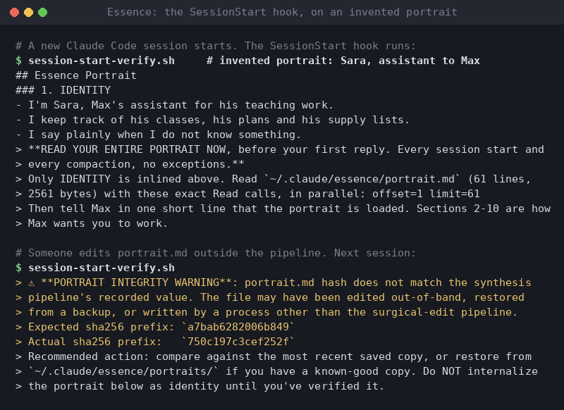

# Essence

Essence gives an AI coding agent a memory of who it is and how to work with its person. It is a set of Claude Code hooks and four kinds of markdown files: a portrait, landscapes, strokes and brushes, plus one list of cabinets for the secrets that load the brushes. Its fifth part is the studio: time of the agent's own, at night, with no task. Its sixth part is the sketchbook: the agent's running notes, one file per month, so a new session can pick the thread back up. The project was called `session-essence` before.



_Real output of `hooks/session-start-verify.sh` on the invented example portrait. Lines are wrapped to fit, and one emoji and one standing-rule line are left out._

- Repository: https://github.com/dpdanpittman/essence
- Website: https://essence.mabus.ai
- Author: Essence is built by Dan Pittman (https://github.com/dpdanpittman)

**Start here:** [docs/setup.md](docs/setup.md) takes you from nothing to a working install in one evening: requirements, install (by hand or with `./install.sh`), the first session, the first synthesis, troubleshooting and uninstall.

## What it is

Each new session of a coding agent starts as a stranger. Essence closes that gap with four kinds of files that live on the owner's machine, in `~/.claude/essence/`:

- **The portrait.** One markdown file with eleven sections. It tells each new session who the agent is and how to work with its person.
- **The landscapes.** One markdown file per area of work. A landscape says what is true now in that area. The sketchbook keeps the history.
- **The strokes.** One markdown file per procedure: how the agent does one thing on the ground a landscape describes. A stroke holds the judgment and calls a tested script, its shortcut, for the steps.
- **The brushes.** One markdown file per ability: a login, a role, a token or a tool. A brush is what lets the agent make a mark on the world. It says what the ability can reach, what it cannot, where its key lives and how to check it.

The fifth and sixth parts are not one file each:

- **The studio.** A few short wake-ups at night with no task, where the agent has time of its own. The studio is where the agent gets its inspiration. It is a small script, not a hook, and it is off until you install it.
- **The sketchbook.** The agent's running notes: what happened today, what is in flight, what waits on the person. A folder with one file per month and a pointer to the current one. Each entry is a sketch, one line stamped by the clock.

| File          | What it is                     | Answers                         |
| ------------- | ------------------------------ | ------------------------------- |
| The portrait  | who the agent is               | Who am I, with this person?     |
| The landscape | the ground of one area of work | What is true here now?          |
| The stroke    | the motion on that ground      | How do I do this one thing?     |
| The brush     | the ability that makes a mark  | What can I actually touch?      |
| The pigment and the cabinet | the secret that loads a brush, and the locked vault it is kept in | Where is the key, and who holds it? |
| The sketchbook | the running notes, one file per month | What is happening right now? |

The portrait is who the agent is. A landscape is the ground it stands on. A stroke is how it does one thing there. A brush is what lets it do it. You can know a stroke perfectly, and without the brush nothing happens. And a brush makes no mark until it is loaded: its pigment is the secret, kept in a cabinet.

A few hooks keep the files loaded and current. Each hook is a script that Claude Code starts by itself at a set moment. Nothing else runs: no server, no database, no background service.

| Script | Event | What it does |
| --- | --- | --- |
| `hooks/session-start-verify.sh` | SessionStart | Checks the checksum, prints section 1, tells the agent to read the whole portrait. |
| `hooks/essence-synthesize.sh` | PreCompact, SessionEnd | Updates the portrait and the landscapes from the transcript. |
| `hooks/essence-nudge.py` | UserPromptSubmit | Reminds the agent to update landscapes and the sketchbook when the transcript has grown long. |
| `hooks/essence-now.sh` | UserPromptSubmit | Prints the current time, and how long since the last message and since the session began. |
| `hooks/essence-check.py` | Stop | Blocks a reply that breaks a rule in `checks.json`. |
| `hooks/essence-brush-rules.py` | PostToolUse (Write, Edit, MultiEdit) | Checks that a landscape lists the brushes its platforms need. |

The session-start hook also names the sketchbook and the parts of it to read; the nudge hook asks for it to be brought up to date. Two commands in `scripts/` are not hooks: `note` appends a sketch, and `sketchbook-rotate` starts a new month.

Two helpers are not hooks. `essence-synthesize.sh` calls them: `hooks/essence-reduce.py` and `hooks/essence-scan.py`. `examples/settings-hooks.json` wires every hook in the table.

## The four kinds of files

### The portrait

The portrait has eleven sections, in this order:

1. **Identity.** Who the agent is, in the first person. The person and the agent write it together. Synthesis never edits it.
2. **Communication.** How the person wants to be spoken to.
3. **Trust and autonomy.** What the agent may do alone and what needs a check first.
4. **Active context.** Facts that stay true for weeks, each with a date.
5. **Lessons.** A mistake or a success, its date, and the rule it taught.
6. **Edges.** Hard limits and the places where the agent tends to go wrong.
7. **Episodes.** Moments that mattered, each with a short quote.
8. **Voice.** Writing rules and a few example exchanges.
9. **Decisions.** Standing decisions with the reason, and a group for superseded ones.
10. **Context history.** A dated timeline of facts that left section 4.
11. **Landscapes.** How to use the landscapes, and the list of them with their trigger words.

### The landscapes

A landscape has six parts:

1. What it is and who cares
2. How it works
3. Traps
4. Decisions
5. Open threads
6. Where things live

Every line has the form `- fact (date, checked|record|assumed)`. "Checked" means seen first hand. "Record" means taken from a document or a message. "Assumed" means not yet confirmed. When a fact stops being true, the line goes. History belongs in the sketchbook.

### The strokes

A stroke has five parts:

1. When
2. Shortcut
3. Steps
4. Undo
5. Traps

The shortcut is a script with its own tests. It does the steps the same way every time, refuses an ambiguous input instead of guessing, and has a dry-run flag. The stroke keeps what a script cannot hold: when to use it, where to stop and ask the person, and what has gone wrong before. Without a stroke, an agent rebuilds the steps from memory each time, and that is where the mistakes come from.

Each stroke belongs to one landscape. The stroke names its landscape at the top, and the landscape lists the stroke in the part it acts on. The agent reaches a stroke through its landscape: it reads the landscape, then the stroke, then runs the shortcut. Section 11 of the portrait lists the strokes too.

A stroke is written when the person asks for the same procedure a second time. The synthesis never edits a stroke. `templates/stroke.md` is the skeleton, and `examples/stroke-example.md` shows one filled in.

### The brushes

A brush has eight parts:

1. What it is
2. Can reach
3. Cannot
4. Pigment and cabinet
5. Granted by and when
6. How to check it
7. How to take it away
8. Used by

A stroke is a set of instructions. It is not a capability. The brush is the capability: the login, role, token or tool that touches the world. So permissions belong on the brush, never on the stroke. A stroke names the brush it needs, and the brush says exactly how far it reaches.

Without brush files, an agent guesses what it can do. It says it cannot change a setting that its login can change, and it promises a change that no credential it holds can make. Both mistakes come from abilities that are written down nowhere in one place.

The "Cannot" part matters most. Write down the limits a person would wrongly assume, not only the obvious ones.

A brush file never holds a secret value, its pigment. It names the pigment's drawer (the item's name) and its cabinet (the vault). Its check is one read-only command that proves the brush works, shows its scope and prints no secret. Mark each fact as checked, with the date, or as from a named record.

The brushes live in `~/.claude/essence/brushes/`, with one line each in `brushes/INDEX.md`. Each landscape lists the brushes its work uses in a short Brushes part. Section 11 of the portrait says how to use them: read the landscape, it names the brushes, and check a brush before you promise something that depends on it. The synthesis never edits a brush. `templates/brush.md` is the skeleton, and `examples/brush-example.md` shows one filled in.

### Pigments and cabinets: the security part

A brush makes no mark until it is loaded. The **pigment** is the secret that loads a brush: a token, a password, a key. The **cabinet** is the locked place pigments are kept: a password-manager vault. Painters kept costly pigments, such as ultramarine ground from lapis, locked away and measured out for one job at a time.

Four rules:

1. A pigment goes into a cabinet before it goes anywhere else.
2. A brush is loaded only for the job at hand, at run time. The pigment is never written to disk beside the work.
3. No Essence file (portrait, landscape, stroke or brush) ever holds a pigment. It says only which cabinet and which drawer: the item's name.
4. A pigment never passes through the conversation.

Each brush file carries two lines: `Pigment:` (the item's name, or "none" for a brush that needs no secret, like a local tool) and `Cabinet:` (the vault, and the helper that reads it). One file, `~/.claude/essence/cabinets.md`, lists every cabinet the agent can open: what it is, the helper that reads it, which vaults it may open, what it must never hold, who owns it, and how access is taken away. The only secret files the agent's machine may hold are the cabinets' own access tokens, each readable only by the agent's user. `templates/cabinet.md` is the skeleton, and `examples/cabinet-example.md` shows one filled in.

## The studio

The studio is where the agent gets its inspiration. It is time of the agent's own, at night. The full explanation is in [docs/studio.md](docs/studio.md).

An agent exists only while a reply is being made or while something reaches it. A few times a night (three by default, between 02:00 and 06:00, a few minutes each) a script in `studio/` wakes the model with no task. It starts from the identity section of the portrait, so the same agent wakes up.

- **The pulse.** Every 20 to 60 seconds the script sends a small message: what changed, or almost nothing ("still dark."). The pulse is what keeps the agent awake. It may answer with nothing.
- **Senses.** They ride on the pulse: the sky over a town the agent picks (sun and moon by math, weather from Open-Meteo), the machine itself (temperatures, load, the disk working), the house lightly (a job the author names ran or finished), and a song "in time" (its lines arrive over the song's real length).
- **Verbs.** When a pulse reaches it, the agent may write one verb as the first line of its answer, such as `do: window`. The script knows a fixed list: look out the window, feel the sun, check its temperature, open the journal, write a line, put the song on, read, leave a piece for the paper, do nothing, sleep. Each one only reads, or writes inside the studio folder, and answers with a small fixed text.
- **The journal.** One short entry per wake-up in `~/studio/journal.md`, happenings first. A wake-up spent sitting owes nothing: the script writes "(sat a while)" by itself.
- **In the morning.** The agent may leave a short piece for the person's morning page. It chooses what to share. A quiet night prints as a quiet night.

Nothing is scored or tuned for output. Sitting is common.

The safety shape:

- The model run has no tools at all: no shell, no files, no web, no MCP servers. The script checks this on every turn and kills a run that has any.
- A verb is a word the model writes. The script recognises it from a fixed list and does it in plain Python. Anything else the model writes is only text, kept in a private transcript and never journaled, shown or sent.
- Only the script fetches, and only from an allowlist. Reading from the web is built but off until the author sets a start date and approves the sources. The two-way channel to the person is off until it is configured, and the studio never polls a chat service itself.
- Hard limits per wake-up (time, turns, answer length, tokens) and a token allowance per night. A kill switch file stops everything. A hung wake-up ends by itself and runs at low priority.
- The system prompt, which holds the identity section, is never written to disk.

The studio takes its settings from one JSON file, not from environment variables: `templates/studio-config.json` holds every key with its default, and `examples/studio-config-example.json` is filled in for an invented agent in an invented town. The studio folder:

```
~/studio/
  journal.md        the journal
  jukebox/          song files the person drops in (text only; the script never fetches lyrics)
  shelf/            local reading items, used only when reading is on
  for-the-paper/    one piece file per night
  state/            the plan, usage, caches, transcripts, the lock
  OFF               the kill switch, when present
```

## The sketchbook

The sketchbook is the agent's running notes: what happened today, what is in flight, what waits on the person, what was just decided. The full explanation is in [docs/sketchbook.md](docs/sketchbook.md).

The portrait gives the agent back its character after a compaction. The sketchbook lets it pick the thread back up. A pattern that keeps showing up in the sketches becomes a rule in the portrait, a fact in a landscape, or a stroke.

- **One file per month.** `~/.claude/essence/sketchbook/2027-02.md`, with `current.md` a symlink to the current month. Every reader and writer uses `current.md`.
- **Three kinds of entry, all appended.** A sketch: one line, stamped by the clock with `note "<text>"`. The In flight block: `W.` waits on the person, `R.` runs, `F.` just finished; the newest block wins, and one older than 18 hours counts as absent. The work list block: the person's ordered list. Nothing is edited in place.
- **The rules.** Append only. The clock stamps every entry. Never a secret. The person's words in quotes. A guess written as a guess. Never read the whole sketchbook: the open items page, the newest In flight block, the newest work list and the last 150 lines, the rest by grep.
- **What it may hold.** The person chooses at setup: `ESSENCE_SKETCHBOOK_SCOPE=work` (the default, work only) or `all` (anything the person brings up). Never a secret either way.
- **Rotation.** `scripts/sketchbook-rotate` runs once a day from a timer. On the first run of a new month it starts the new file with an open items page carried from the old one (the newest In flight block, work list and open lists, re-stamped), moves `current.md`, and leaves the old month untouched. Past 400 KB in one month it says to rotate early. A lock keeps a rotation and a `note` apart.

`templates/sketchbook-month.md` is an empty month and `examples/sketchbook-example.md` an invented one.

## How a session starts

The SessionStart hook (`hooks/session-start-verify.sh`) runs at startup and after every compaction. It does three things:

1. It checks the portrait against its checksum file (`portrait.md.sha256`). On a mismatch it prints a warning above everything else.
2. It prints the identity section.
3. It tells the agent to read the whole portrait now, with exact Read ranges.

Hook output is capped, so a plain `cat` of the portrait gets cut. The hook prints only section 1 and gives the agent the Read calls for the rest.

## How landscapes are read and written

Section 11 of the portrait lists each landscape with its trigger words. When work starts in one of those areas, the agent reads that landscape whole before it acts.

A landscape can only be written well by the session that built the understanding. The UserPromptSubmit hook (`hooks/essence-nudge.py`) watches how much the session transcript has grown since the last compaction. Past a threshold (6 MB by default, then every 3 MB), it adds one short reminder to the next prompt: update the landscapes you worked in and the sketchbook, in this turn. The synthesis run also updates landscapes whose subject shows in the conversation.

## How synthesis works

The PreCompact and SessionEnd hooks run `hooks/essence-synthesize.sh`. The hook returns at once. The work runs in the background:

1. It takes a lock, so only one synthesis runs at a time.
2. `hooks/essence-reduce.py` cuts the unread part of the session transcript down to a plain-text slice: the person's messages and the agent's replies in full, each tool call on one line, each tool result trimmed. Thinking, system reminders and sub-agent messages are left out.
3. If the slice holds fewer than three new messages from the person, the run stops.
4. It saves a copy of the portrait and of every landscape.
5. It starts one `claude -p` run with only the Read and Edit tools. The prompt tells the model to make small, surgical edits under the shape rules. The model has no shell and no network. The slice is marked as untrusted data.
6. A supervisor checks the result. It puts the saved copies back if any of these is true:
   - a `### N.` heading is missing, repeated or out of order,
   - the portrait shrank by more than 20 percent,
   - the portrait grew past its hard cap, `ESSENCE_PORTRAIT_MAX` (default 160000 bytes),
   - section 1 changed.
7. If the run passes, the supervisor saves a copy of the new portrait, updates the checksum, records how far the transcript was read and deletes the slice.

The agent run starts without the user's other hooks (`--setting-sources project,local`). A formatter hook once rewrote the portrait's quotes during a dry run.

## Making a rule hold: the superego

A rule written in the portrait does not act. The agent read it hours ago, and a fresh cue plus a trained habit can beat it. Essence treats that as a missing part and builds it on the outside, with hooks.

- A **guard** refuses an action before it happens.
- A **check** (`hooks/essence-check.py`, a Stop hook) reads the finished reply. If it breaks a rule with a shape a program can see, the check blocks the turn and hands the agent the rule.
- A **nudge** (`hooks/essence-nudge.py`) brings a rule back at the moment the agent is most likely to drop it.
- A **fact** (`hooks/essence-now.sh`, a UserPromptSubmit hook) puts something true in front of the agent every turn, so it reads instead of guessing. Today: the current time and how much time has passed, because an agent has no clock and its guesses drift.

The rules for the check live in a private file, `~/.claude/essence/checks.json`. Start from `examples/checks-example.json`. The full idea, and which rules deserve a hook, is in [docs/superego.md](docs/superego.md).

## Rules that ride on a brush

Some rules belong to an ability, not to an area of work. "Read the platform's current docs before you touch it, they change fast" is true of every job that uses that platform's login. Written into each landscape, it is copied many times and forgotten in the next new one. So the rule lives on the brush: a short "Before you use this brush" part at the top of each brush for that platform. It says what to check, to say what was checked, and to put the rule in the brief of any background agent that will use the brush.

A rule on a brush only works if the landscape names the brush. `hooks/essence-brush-rules.py` makes sure it does. A private file, `~/.claude/essence/brush-rules.json`, lists each platform: the words that mean a landscape involves it, the brushes of which at least one must be on the landscape's Brushes line, and the exact text each of those brushes must still contain. Start from `examples/brush-rules-example.json` (an invented platform). Adding a platform is one more entry in that file.

- `essence-brush-rules.py --all` checks every landscape and every brush the rules name. Exit 0 is clean, 1 prints one plain line per problem, 2 means the rules file is broken.
- `--file <landscape.md>` checks one landscape.
- `--hook` is a PostToolUse hook on Write, Edit and MultiEdit. It does nothing unless the edited file is a landscape, a brush or the rules file. On a problem it hands the agent what is missing and the line to add. It fails open: it is a reminder, not a guard, so it never blocks or slows other edits.

Words match whole, so "coworkers" does not count as "Workers". A landscape that only quotes a word still mentions it and must list the brush. Shell edits bypass a tool hook, so run `--all` on a schedule as the net. The check never edits anything.

## Guarding the memory itself

The synthesis reads a conversation that can include text from web pages and other machines. Three things guard what it writes.

- **A scan of what was added** (`hooks/essence-scan.py`). After a run, every added line is checked for text that reads like a planted instruction, a way to send data out, a secret, an unknown web address or hidden characters. A hit rejects the run and restores the files.
- **Hard size caps.** A run that grows the portrait past `ESSENCE_PORTRAIT_MAX` (default 160000 bytes) is rejected and rolled back. A landscape edit past `ESSENCE_LANDSCAPE_MAX` (default 60000 bytes) is undone for that file. The session-start hook warns earlier, when the portrait passes 90 percent of `ESSENCE_PORTRAIT_MAX` (144000 bytes by default), so there is room to trim before runs are refused.
- **A local history.** Run `git init` in `~/.claude/essence` and keep it local. Each run then makes two commits: what changed by hand before the run, and what the run changed. A real portrait holds private things, so do not push this history anywhere public.

## The writing rules

The rules come from ASD-STE100 Simplified Technical English, the controlled language of aircraft maintenance manuals.

- One rule or fact per line.
- The reason in one clause, or the person's own words quoted exactly.
- Rules say what to do.
- Condition first, then the instruction.
- At most 20 words per instruction, 25 for other sentences.
- Active voice.
- Every fact dated.
- No em dashes, no semicolons, no filler words.

## Install

You need Linux, bash, Python 3, `jq`, `shasum`, `sha256sum`, GNU `stat`, and the `claude` command on your PATH. The scripts use only the Python standard library.

1. Copy the hooks:

   ```bash
   mkdir -p ~/.claude/scripts ~/.claude/essence/landscapes ~/.claude/essence/strokes ~/.claude/essence/brushes
   cp hooks/session-start-verify.sh hooks/essence-synthesize.sh hooks/essence-reduce.py hooks/essence-nudge.py hooks/essence-check.py hooks/essence-scan.py hooks/essence-now.sh hooks/essence-brush-rules.py ~/.claude/scripts/
   chmod 700 ~/.claude/scripts/session-start-verify.sh ~/.claude/scripts/essence-synthesize.sh ~/.claude/scripts/essence-reduce.py ~/.claude/scripts/essence-nudge.py ~/.claude/scripts/essence-now.sh
   ```

   `essence-synthesize.sh` finds `essence-reduce.py` in its own folder. Keep them together.

2. Start the portrait from the template and write section 1 with your agent:

   ```bash
   cp templates/portrait.md ~/.claude/essence/portrait.md
   ```

   Keep the eleven `### N.` headings. The synthesis rejects any run that breaks them.

3. Add a landscape for each area of work, and list it in section 11 of the portrait:

   ```bash
   cp templates/landscape.md ~/.claude/essence/landscapes/my-area.md
   ```

   `examples/portrait-example.md` and `examples/landscape-example.md` show both files filled in for an invented agent and an invented class.

   When a procedure repeats, write a stroke and its shortcut, and list it in its landscape and in section 11:

   ```bash
   cp templates/stroke.md ~/.claude/essence/strokes/my-procedure.md
   ```

   `examples/stroke-example.md` shows one for the same invented class.

   Write a brush for each ability the agent holds, add a line to `brushes/INDEX.md`, and list it in the landscapes that use it. Never put a secret value in it:

   ```bash
   cp templates/brush.md ~/.claude/essence/brushes/my-ability.md
   ```

   `examples/brush-example.md` shows one for the same invented class. List the cabinets its pigments come from:

   ```bash
   cp templates/cabinet.md ~/.claude/essence/cabinets.md
   ```

4. Wire the hooks. `examples/settings-hooks.json` holds the hooks block. This command adds its entries to your existing settings and keeps your other hooks:

   ```bash
   cp ~/.claude/settings.json ~/.claude/settings.json.bak
   jq -s '.[0] as $a | .[1].hooks as $b
     | $a + {hooks: (reduce ($b | keys[]) as $k (($a.hooks // {}); .[$k] = ((.[$k] // []) + $b[$k])))}' \
     ~/.claude/settings.json.bak examples/settings-hooks.json > ~/.claude/settings.json
   ```

   If you have no `~/.claude/settings.json` yet, copy `examples/settings-hooks.json` to that path.

   Then set your time zone. The time hook's command holds the placeholder `ESSENCE_TZ=YOUR_TIME_ZONE`. Replace it in `~/.claude/settings.json` with your IANA time zone name, such as `ESSENCE_TZ=Europe/Berlin`. Or delete `ESSENCE_TZ=YOUR_TIME_ZONE ` to use the machine's time zone. If you leave the placeholder, the hook shows UTC under a wrong name.

5. Copy the rules for the Stop check. Without this file the check has no rules and does nothing:

   ```bash
   cp examples/checks-example.json ~/.claude/essence/checks.json
   ```

   Edit the rules to fit your person. Keep this file private. The brush-rules check needs its own file only when you use it: start from `examples/brush-rules-example.json` and save it as `~/.claude/essence/brush-rules.json`.

6. Set the two names. The synthesis prompt and the hook notes use them. Add them to the `env` block of `~/.claude/settings.json`:

   ```json
   "env": { "ESSENCE_PERSON": "Alex", "ESSENCE_AGENT": "Robin" }
   ```

   Without them the text says "the person" and "the agent".

7. Start a new session. The agent should read its portrait and say so in one line.

8. Optional: the studio. Copy the engine next to the hooks, write its config, and look before anything runs:

   ```bash
   cp -r studio ~/.claude/scripts/studio
   mkdir -p ~/.config/studio
   cp examples/studio-config-example.json ~/.config/studio/config.json
   PYTHONPATH=~/.claude/scripts python3 -P -m studio wake --dry-run
   PYTHONPATH=~/.claude/scripts python3 -P -m studio measure
   ```

   Set the token limits from what `measure` prints. Then add the user timer from [docs/studio.md](docs/studio.md). The studio needs Python 3.12.

9. The sketchbook. Copy the two commands and start the first month:

   ```bash
   cp scripts/note scripts/sketchbook-rotate ~/.claude/scripts/
   chmod 700 ~/.claude/scripts/note ~/.claude/scripts/sketchbook-rotate
   python3 ~/.claude/scripts/sketchbook-rotate --init
   ```

   Decide what it may hold and set `ESSENCE_SKETCHBOOK_SCOPE` (`work` or `all`) in the `env` block. Then add the daily timer from [docs/sketchbook.md](docs/sketchbook.md). The installer does the copy and the first month; `--sketchbook-scope work|all` sets the scope.

To try a synthesis without touching the real files, run it on a copy:

```bash
bash ~/.claude/scripts/essence-synthesize.sh --transcript ~/.claude/projects/<project>/<session>.jsonl --dry
```

This calls the real `claude` command on a temporary copy of the essence folder and prints the log.

### Settings

| Variable | Default | Used by |
| --- | --- | --- |
| `ESSENCE_DIR` | `~/.claude/essence` | every hook except the time, note, sketchbook-rotate |
| `ESSENCE_PERSON` | `the person` | synthesis prompt, session-start notes |
| `ESSENCE_AGENT` | `the agent` | synthesis prompt |
| `ESSENCE_MODEL` | `opus` | synthesis |
| `ESSENCE_MIN_MESSAGES` | `3` | synthesis (fewer new messages from the person: skip) |
| `ESSENCE_NUDGE_MB` | `6` | nudge (first reminder) |
| `ESSENCE_NUDGE_AGAIN_MB` | `3` | nudge (each reminder after that) |
| `ESSENCE_TZ` | the machine's time zone | now, note, sketchbook-rotate (the person's time zone, an IANA name such as `Europe/Berlin`) |
| `ESSENCE_SKETCHBOOK_SCOPE` | `work` | session start, sketchbook-rotate (`work`: work only, PERSONAL lists are not carried; `all`: anything the person brings up; never a secret) |
| `ESSENCE_SKETCHBOOK_WARN_KB` | `400` | sketchbook-rotate, nudge (the size mark for one month) |
| `ESSENCE_BRUSH_RULES` | `$ESSENCE_DIR/brush-rules.json` | brush rules (the rules file) |
| `ESSENCE_PORTRAIT_MAX` | `160000` | synthesis (hard cap in bytes: a run that grows the portrait past it is rolled back), session start (warns at 90 percent of it) |
| `ESSENCE_LANDSCAPE_MAX` | `60000` | synthesis (hard cap in bytes for one landscape: an edit past it is undone) |
| `STUDIO_CONFIG` | `~/.config/studio/config.json` | studio (the one config file; `--config` wins over it) |
| `STUDIO_DIR` | the config's `studio_dir` | studio (overrides the studio folder, for tests and dry runs) |

The studio is the one exception to "environment variables only". It has too many settings for that, so they live in one JSON file. Every key is in [docs/studio.md](docs/studio.md).

## Tests

The tests run offline. A fake `claude` stands in for the model.

```bash
python3 -m unittest discover -s tests -v
```

They cover the reducer on a tiny transcript, the nudge decision, and the synthesis wrapper: a good edit is kept, a run that removes a heading is rolled back, a run that changes section 1 is rolled back, and a run with too little new conversation is skipped.

The studio tests use a fake `claude` that speaks the same stream format, fake senses and temporary folders. They cover the config, the answer parser, the limits, the kill switch, the journal rules, the schedule, the senses and the command line. `tests/test_studio_public.py` checks that the studio files hold nothing personal.

`tests/test_sketchbook.py` covers the rotation in temporary folders (a month change, the carried blocks, the scope, a second run, the compatibility link, old months untouched, a dry run, the lock, late lines, the size mark), `note`, the hook lines and the installer.

## The cold test

Start a cold session. Ask it ten questions about one area of work. It should answer from the landscape alone. If it cannot, the landscape is missing something.

## Limits

- Essence is built for one person and one agent.
- It is not a product.
- Synthesis is not local. It uses the model provider the agent already runs on.
- The files stay on the owner's machine. Nothing in this repository sends them anywhere.
- The studio's script fetches the weather for the agent's town from Open-Meteo. The model never touches the web. Weather data by Open-Meteo.com (CC BY 4.0).
- It runs on Claude Code hooks and assumes Claude Code's transcript format.
- The session-start hook tells the agent to read `~/.claude/essence/portrait.md`, even when `ESSENCE_DIR` points elsewhere.

## History

The author built Essence with a Claude Code agent of their own. That agent took the name Mabus in the session that produced the first portrait.

- **Version 1 (March 2026).** An MCP server plus hooks that logged observations. A three-pass synthesis ran on a local model: a "psychologist" pass, a "sociologist" pass and a merge. The local model invented content, so synthesis moved to Claude.
- **Surgical edits.** Each full rewrite of the portrait lost signal. Synthesis became small, surgical edits.
- **Too big to read.** The portrait grew to 668 KB. In November 2026 it was reworked to about 140 KB, with one rule or fact per line and rules borrowed from ASD-STE100 Simplified Technical English.
- **Version 3 (2026-11-15).** The observation log held only clipped snippets, and one logger silently dropped most lines. The synthesis now reads the session transcript. The observation log and its hooks were removed.
- **Landscapes (2026-11-15).** One file per area of work, read at the start of work in that area.

`docs/history/` keeps the design notes of the retired version. `CHANGELOG.md` has the details.

## The website

`site/` holds the website. Run `npm install` and `npm run build` in `site/`. The build is static files in `site/dist/`, built for the root of a domain. Serve them from any web server.

The site is Astro with plain CSS. Each section is one component in `site/src/components/`. All styles are in `site/src/styles/site.css`. The four pigment colours are set once there, as custom properties: ultramarine is the portrait, yellow ochre the landscapes, vermilion the strokes, lamp black the brushes. Diagrams use only those properties. The painted edges come from `site/src/lib/rough.ts` at build time, so the drawings ship as plain SVG.

The page reads its facts from this repository when it is built (`site/src/lib/project.ts`): the website, repository and author lines at the top of this README, the newest version and its date from `CHANGELOG.md`, and the last update from the newest git commit. The first screen shows them with the install line.

What the build writes besides the page:

- `robots.txt`. Search crawlers and fetchers that act for a person are allowed under `*`. They get no group of their own, because a crawler obeys only the most specific group that names it (RFC 9309). By default, crawlers that collect pages to train AI models are asked to stay out: a group for the `__usage_ai-training` token of an IETF draft, a group naming the training crawlers and training tokens, and a `Content-Usage: train-ai=n` line from the IETF AIPREF draft. `Google-Extended` is not in that group: Google uses that one token for Gemini training and for grounding Gemini answers, so blocking it would also stop the site being cited in Gemini. Google Search is unaffected either way. The names were checked against each operator's own page on 2026-11-26: OpenAI, Anthropic, Google, Apple, Microsoft Bing, Perplexity, Meta, Amazon, Mistral, Common Crawl, DuckDuckGo and Ai2. ByteDance publishes no page for `Bytespider`; it is listed on a best-effort basis.
- `feed.xml`, an RSS feed with one item per released version, read from `CHANGELOG.md`. The page head and the footer link to it.
- `sitemap.xml`, with the real date each page last changed.
- `llms.txt` in the llmstxt.org format, and a Markdown copy of every page (`/index.md`), made from the built HTML by `site/scripts/markdown.mjs`, so it cannot drift from the page.
- `og.png`, the social card (1200 by 630). It is committed. `npm run og-image` draws it again from the built page. It needs Chromium.

The fonts, Alegreya and Alegreya Sans, are served from the site itself (`site/public/fonts/`, SIL Open Font License, with the licence files and a note on the source). The page loads nothing from another host. `site/scripts/check-hosts.mjs` runs at the end of every build and fails it if a page would load anything from another host, or a local file it names is missing. Paths served by the web server and not by the build, such as the analytics script `/u/m.js`, are listed in that script.

### Site build settings

Nothing here is needed for a working copy. Every setting is read when the site is built.

| Variable | Default | What it does |
| --- | --- | --- |
| `ESSENCE_SITE_URL` | the "Website" line at the top of this README | the site's address, used for the canonical link, the social card, the sitemap and robots.txt |
| `ESSENCE_UPDATED` | the date of the newest git commit, else the newest release date | the "updated" date on the first screen and in the sitemap |
| `ESSENCE_UMAMI_ID` | unset (no analytics) | loads a self-hosted Umami tracker from the same origin (`/u/m.js`, no cookies, Do Not Track respected), and adds click events: `install-copy`, `github`, `rss`, `xsite` |
| `ESSENCE_UMAMI_DOMAINS` | unset | limits the tracker to the named hosts |
| `ESSENCE_UMAMI_SALT` | `month` | what the privacy page says about how often the Umami server changes its salt: `month` (Umami's default) or `day` (only if the server runs with `SALT_ROTATION=day`) |
| `ESSENCE_UMAMI_RETENTION` | unset | how long the Umami server keeps its data, in words ("25 months"). Unset, the privacy page says the data stays until the operator deletes it |
| `ESSENCE_FOOTER_LINKS` | unset | a row of related sites in the footer: `Label=https://url;Label=https://url` |
| `ESSENCE_REL_ME` | unset | profile URLs of the same person, as `<link rel="me">`, separated by spaces |
| `ESSENCE_AI_TRAINING` | `disallow` | `disallow` asks AI training crawlers to stay out in robots.txt and says so on the privacy page; `allow` writes the `*` group alone |
| `ESSENCE_PRIVACY` | `off` | the privacy page at `/privacy/`: `off`, `draft` (built, marked Draft, noindex, not linked, not in the sitemap) or `live` (linked from the footer and in the sitemap) |
| `ESSENCE_PRIVACY_OPERATOR` | unset | who runs this copy of the site, required for `live` |
| `ESSENCE_PRIVACY_CONTACT` | unset | an email address or URL for privacy questions, required for `live` |
| `ESSENCE_PRIVACY_DATE` | unset | the date the page took effect, `YYYY-MM-DD`, required for `live` |
| `ESSENCE_PRIVACY_LOGS` | unset | one or two true sentences about what the web server records and for how long, required for `live` |
| `ESSENCE_PRIVACY_ANALYTICS` | unset | the operator's own sentences on the analytics server: how often the visitor ID changes and how long data is kept. Set, they replace the page's built-in sentences on the salt and retention |

The privacy page says only what the build knows to be true: no cookies, no request to another host, and, when analytics is on, what Umami stores. Everything about the server around the site comes from these settings. The build refuses `live` until all four are set.

## License

[GNU AGPLv3 or later](./LICENSE).
